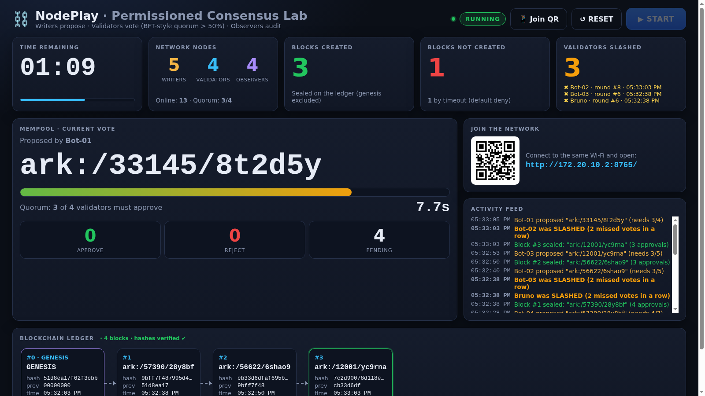
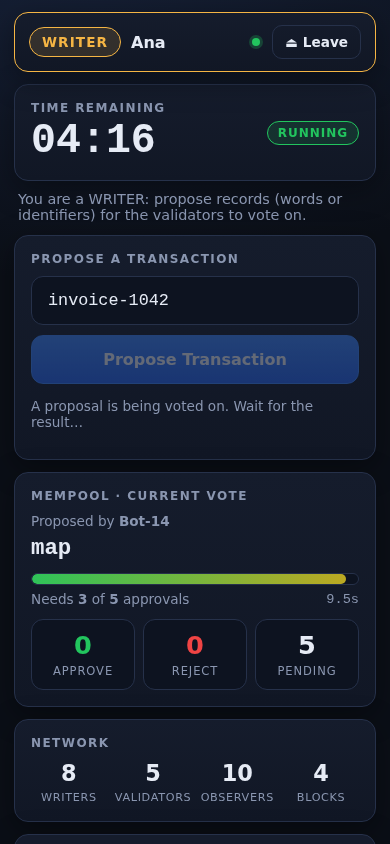
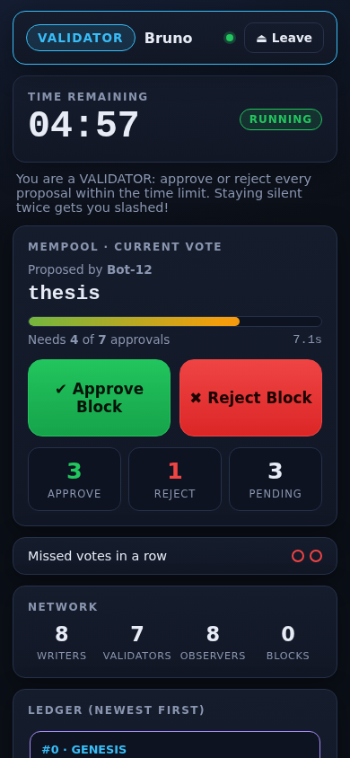
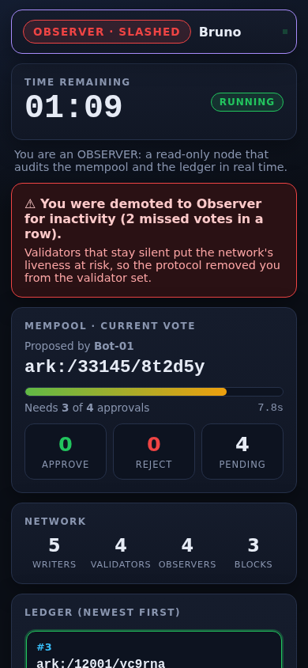

# ⛓️ NodePlay — Permissioned Consensus Lab

**A 5-minute, hands-on classroom activity where up to 30+ people turn their phones into the nodes of a permissioned blockchain.**

Participants scan a QR code and are automatically assigned a role: **Writers** propose records, **Validators** vote to seal them into blocks, and **Observers** audit the ledger in real time. A projector dashboard shows the mempool, the voting countdown, the hash-linked ledger, and validators being *slashed* for inactivity.

No app to install, no internet connection needed. One laptop and a local Wi-Fi network are enough.



| Writer | Validator | Slashed validator |
|:---:|:---:|:---:|
|  |  |  |

---

## Why this project?

Public blockchains such as Bitcoin let *anyone* join and use costly Proof-of-Work to agree on history. Many institutional networks are **permissioned** instead. They have a known set of nodes, and a small committee of validators reaches agreement through **Byzantine Fault Tolerant (BFT)** voting. One example is [Hyperledger Besu](https://besu.hyperledger.org/) running the IBFT 2.0 or QBFT consensus protocols.

**dARK (Decentralized Archival Resource Key)** follows this model. It is an initiative to run [ARK persistent identifiers](https://arks.org/), the stable identifiers for scholarly and archival objects such as `ark:/80444/xt9bk2`, on a permissioned blockchain. Institutions *write* identifiers, a set of *validator* nodes agrees on them, and anyone can *observe* and audit the resulting ledger.

NodePlay turns that architecture into a game people can feel:

| Concept | What participants experience |
|---|---|
| Proposer / block producer | Writers race to get their record into the single-slot mempool |
| BFT voting committee | Validators have 10 seconds to approve or reject each proposal |
| Quorum | A block is sealed only if **more than 50%** of active validators approve |
| Liveness vs. safety | If too few validators answer in time, nothing is written (**default deny**) |
| Slashing / validator-set changes | Validators who miss 2 votes in a row are removed, and the quorum shrinks |
| Immutability | Each block stores the hash of the previous one, and the dashboard re-verifies the chain |
| Read-only / audit nodes | Observers see everything and can change nothing |

> **A simplification, on purpose:** real BFT protocols such as IBFT 2.0 and QBFT need a **⌈2n/3⌉** super-majority so they tolerate `f` faulty nodes out of `3f+1`. NodePlay uses a simple majority (> 50%) so that a room of 7 validators produces blocks often enough to keep 5 minutes lively. This is a good discussion point for the debrief.

---

## Rules of the game

1. **Automatic roles.** Roles are assigned in the order people connect:
   - first **5** → `WRITER`
   - next **7** → `VALIDATOR`
   - everyone else → `OBSERVER`

   When someone disconnects, the network metrics update instantly. A phone that reconnects (after a reload or a locked screen) gets its role back within 60 seconds. A vacancy left by someone who never returns is filled by the next person to join.
2. **Global timer.** Nothing can be proposed until the facilitator presses **START**. The activity then runs for **5 minutes**, synchronised with the server clock on every screen. When time is up, the mempool closes. A vote already in progress is still allowed to finish.
3. **One proposal at a time.** A writer submits a word or an ARK identifier (up to 48 characters). While it is being voted on, nobody else can propose. For fairness, a writer can't propose twice in a row while other writers are online.
4. **10-second vote.** The validators who are active when the proposal arrives form the voting committee. The quorum is `floor(N/2) + 1`.
   - Approvals ≥ quorum → **block created** and appended to the ledger.
   - Anything else, including a **timeout**, → **block not created** (default deny).
   - The round closes early when every validator has voted.
5. **Slashing.** Each validator on the committee who doesn't vote gets a strike, and voting clears the strikes. **2 consecutive strikes** demote the validator to `OBSERVER` for the rest of the activity, and their phone shows: *"You were demoted to Observer for inactivity."* The validator count and the quorum are recalculated for the next round. Slashed validators are not replaced, so the network really does lose them.
6. **Ledger.** A genesis block is created when the server starts and on every reset. Each block contains `index`, `timestamp`, `tx`, `prev_hash` (the first 8 hex characters of the previous block's hash) and `hash` (SHA-256 of the block). It also records who proposed it and the vote count.

---

## Quick start

**Requirements:** Python 3.10+ and a laptop connected to the same Wi-Fi as the participants.

```bash
git clone https://github.com/EdilsonFilho/blockchain-nodeplay.git
cd blockchain-nodeplay

python3 -m venv .venv
source .venv/bin/activate          # Windows: .venv\Scripts\activate

pip install -r requirements.txt

cp .env.example .env               # then edit the Wi-Fi name/password
```

### Configure the venue network (`.env`)

The `.env` file is where you describe the venue, so nothing needs to change in the code when you move to another room or network:

```ini
WIFI_SSID=IOI-Blockchain-Lab   # Wi-Fi every participant must join
WIFI_PASSWORD=dark2026!        # shown on the projector, on purpose
WIFI_SECURITY=WPA              # WPA | WEP | nopass (optional)
HOST_IP=                       # empty = auto-detect the IP at startup
```

- **Wi-Fi.** When `WIFI_SSID` is set, the dashboard shows the network name, the password, and a **"join Wi-Fi" QR code**. Android and iOS camera apps connect to the network straight from that code. Joining is step ①; opening NodePlay is step ②.
- **IP address.** The server IP is **captured automatically when the service starts**. It is printed in the console and encoded in the join QR code. If you change networks, restart the server so it picks up the new IP. Set `HOST_IP` (or a full `PUBLIC_URL`) only if detection picks the wrong interface, for example because of a VPN, Docker, or several network cards.
- `.env` is listed in `.gitignore`, so the venue's real password is never committed. Only `.env.example` is versioned.

### Run

```bash
uvicorn main:app --host 0.0.0.0 --port 8000
```

or, equivalently, run the following, which also prints the URLs to share:

```bash
python main.py
```

```
  Projector dashboard : http://192.168.0.10:8000/dashboard
  Participants (QR)   : http://192.168.0.10:8000/
  Wi-Fi network       : IOI-Blockchain-Lab  (password: dark2026!)
```

`--host 0.0.0.0` is required. It makes the server reachable from other devices on the network, not only from the laptop.

---

## Connecting 30 devices on a local network

1. **Put everybody on the same network.** Connect the laptop and all phones to the Wi-Fi set in `.env`. The dashboard shows its name, password and QR code.
   - Classroom or event Wi-Fi often has **client isolation** ("AP isolation") turned on, which blocks phones from reaching the laptop. If participants can't connect, use a dedicated router or turn the **laptop or a phone into a hotspot**. Most hotspots handle 30 clients poorly, though, so a cheap travel router is the most reliable option.
2. **Open the dashboard on the projector:** `http://<laptop-ip>:8000/dashboard`. It works from `localhost` too; the QR code always points to the laptop's LAN address.
3. **Show the QR codes.** Press **📱 Join QR** for a full-screen view with two codes: ① join the Wi-Fi and ② open NodePlay. Participants scan both with their camera app, optionally type a nickname, and tap **Connect as a node**.
   - If scanning fails, they can type the network name, the password, and the URL shown under the codes, e.g. `http://192.168.0.10:8000`.
   - If the IP is detected wrongly (VPNs, several network cards), set `HOST_IP=192.168.0.10` in `.env` and restart.
4. **Allow the port through your firewall** if phones time out:
   - Linux (ufw): `sudo ufw allow 8000/tcp`
   - Windows: accept the "Allow access" prompt for Python on **private networks**.
   - macOS: allow incoming connections for Python when prompted.
5. Wait until the **Network nodes** card shows everyone, then press **▶ START**.

### Finding your IP address manually

| OS | Command |
|---|---|
| Linux | `hostname -I` |
| macOS | `ipconfig getifaddr en0` |
| Windows | `ipconfig` → "IPv4 Address" |

---

## Facilitator script (≈ 10 minutes in total)

| Time | What to do |
|---|---|
| −2 min | Show the QR code and let everyone join. Ask people to keep the page open and the screen on. |
| 0:00 | Explain the three roles in one sentence each, then press **START**. |
| 0:00 – 5:00 | Narrate the dashboard: *"Look, a timeout means no block!"*, *"Bot-07 was slashed, so the quorum just dropped to 3 of 5."* |
| 5:00 | Time is up. Look at the ledger: how many blocks were sealed, rejected, slashed? |
| Debrief | Why default deny? What happens to liveness when validators go silent? Why do real BFT networks need 2/3? Who should be allowed to be a validator in a network like dARK? |

Press **↺ RESET** (or **▶ NEW ROUND** after the timer ends) to play again. A reset seals a new genesis block, brings slashed validators back, and re-assigns roles in join order.

---

## Configuration

Every setting can be placed in `.env` (see [`.env.example`](.env.example)) or passed as an environment variable. Variables set in the shell take precedence over `.env`.

| Variable | Default | Meaning |
|---|---|---|
| `GAME_DURATION` | `300` | Activity length in seconds |
| `VOTE_TIMEOUT` | `10` | Seconds validators have to vote |
| `RESULT_PAUSE` | `2` | Seconds a result stays on screen before the mempool reopens |
| `MAX_WRITERS` | `5` | Writer quota |
| `MAX_VALIDATORS` | `7` | Validator quota |
| `MAX_MISSED_VOTES` | `2` | Consecutive missed votes before slashing |
| `MAX_TX_LENGTH` | `48` | Maximum characters per proposal |
| `ADMIN_TOKEN` | *(empty)* | If set, only `/dashboard?token=<value>` can press START/RESET; other dashboards are read-only |
| `WIFI_SSID` | *(empty)* | Wi-Fi network participants must join; shown on the dashboard with a join QR code |
| `WIFI_PASSWORD` | *(empty)* | Wi-Fi password, displayed on the dashboard |
| `WIFI_SECURITY` | `WPA` / `nopass` | `WPA`, `WEP` or `nopass`; inferred from the password when empty |
| `HOST_IP` | *(auto)* | Server IP for the join QR code; auto-detected at startup when empty |
| `PUBLIC_URL` | *(empty)* | Full base URL; overrides `HOST_IP` and auto-detection |
| `PORT` | `8000` | Port used by `python main.py` |

Example of a quick rehearsal:

```bash
GAME_DURATION=60 VOTE_TIMEOUT=5 ADMIN_TOKEN=secret uvicorn main:app --host 0.0.0.0 --port 8000
# then open http://localhost:8000/dashboard?token=secret
```

> If participants can open `/dashboard`, set an `ADMIN_TOKEN` so nobody but you can press RESET mid-game.

---

## Rehearse without people: the bot simulator

`tools/simulate.py` connects bot nodes that join in order, propose random ARK identifiers, and vote. Some of them stay silent, so you can watch slashing happen.

```bash
# terminal 1
python main.py
# terminal 2
python tools/simulate.py --nodes 30 --silence 0.3
# open http://localhost:8000/dashboard and press START
```

| Option | Default | Meaning |
|---|---|---|
| `--url` | `ws://127.0.0.1:8000` | Server address |
| `--nodes` | `30` | Number of bots |
| `--silence` | `0.2` | Average chance that a validator skips a vote |
| `--approve` | `0.75` | Chance that a cast vote is an approval |

You can also open the participant page on your own phone while bots fill the other seats. If you join before starting the bots, you get a writer slot.

---

## Project structure

```
blockchain-NodePlay/
├── main.py                 # FastAPI app: HTTP routes + WebSocket endpoints
├── nodeplay/
│   ├── config.py           # Settings from .env / environment variables
│   ├── engine.py           # Roles, game timer, consensus rounds, slashing, broadcasting
│   ├── ledger.py           # Blocks, SHA-256 hashing, chain verification
│   └── network.py          # LAN IP detection + URL and Wi-Fi QR codes (SVG)
├── static/
│   ├── index.html          # Participant client (phones)
│   ├── dashboard.html      # Projector dashboard
│   ├── css/                # style.css (shared), client.css, dashboard.css
│   └── js/                 # common.js (WebSocket, clock sync, renderers), node.js, dashboard.js
├── tools/simulate.py       # Bot swarm for rehearsals and load testing
├── docs/                   # Screenshots
├── .env.example            # Venue settings template (copy to .env)
├── requirements.txt
└── LICENSE
```

### Architecture

```
 Phones (Vanilla JS)          FastAPI + Uvicorn (single process)           Projector
 ┌──────────────┐  /ws/node   ┌──────────────────────────────────┐ /ws/dashboard ┌───────────┐
 │ WRITER       │────────────▶│ Engine (asyncio, single source   │◀─────────────│ Dashboard │
 │ VALIDATOR    │◀────────────│ of truth)                        │─────────────▶│ START /   │
 │ OBSERVER     │ state push  │  roles · timer · mempool · votes │ state push   │ RESET     │
 └──────────────┘             │  slashing · Ledger (SHA-256)     │              └───────────┘
                              └──────────────────────────────────┘
```

- **The server is authoritative.** Every rule (role checks, the single-slot mempool, deadlines, quorum, slashing) is enforced on the server. The browser only renders state and sends intents, so a curious participant who opens DevTools can't cheat.
- **Push, not poll.** After every change the server pushes a full snapshot to every client. Each node also receives its own fields (`you.role`, `you.vote`, `you.missed`…). With 30 clients and a ledger of a few dozen blocks, this is simpler and more robust than sending diffs.
- **Clock-independent timers.** Messages carry `server_time`. Clients compute their offset from it, so countdowns match on every phone even when a phone's clock is wrong.
- **Resilient clients.** A random session id is kept in `localStorage`. With it, clients reconnect automatically with backoff and get their role back after a reload, a screen lock, or a Wi-Fi hiccup.
- **Safe rendering.** User input (nicknames, transactions) is sanitised on the server and always inserted with `textContent`, never `innerHTML`.

### WebSocket protocol

| Direction | Message |
|---|---|
| node → server | `{"type": "propose", "tx": "ark:/80444/xt9bk2"}` |
| node → server | `{"type": "vote", "round": 3, "approve": true}` |
| dashboard → server | `{"type": "start"}` · `{"type": "reset"}` |
| server → all | `{"type": "state", "phase", "ends_at", "round", "metrics", "stats", "ledger", "events", "you"? ...}` |
| server → one | `{"type": "notice", "level": "warn" \| "danger", "text": "..."}` |

---

## Troubleshooting

| Symptom | Fix |
|---|---|
| Phones can't open the page | Same Wi-Fi? Firewall open? Client isolation on the router? Try a hotspot or a dedicated router. |
| QR code points to the wrong IP | Restart the server after switching networks, or set `HOST_IP=<ip>` in `.env`. |
| Wi-Fi panel does not appear | `WIFI_SSID` is empty or `.env` is missing. Run `cp .env.example .env`, edit it, and restart. |
| Everyone is an Observer | Writer/validator seats are taken by earlier connections, such as bots. Press **RESET** to re-assign roles in join order. |
| "This session was opened in another tab" | The same browser opened the page twice. Only the newest tab stays connected. |
| A phone shows a red dot in the header | It lost the connection. It reconnects automatically; tapping the screen or reopening the tab speeds this up. |

---

## Contributing

Issues and pull requests are welcome. Ideas: a ⌈2n/3⌉ BFT quorum mode, Byzantine (malicious) validators, a ledger export (JSON/CSV), and i18n.

## License

Released under the [MIT License](LICENSE). Use it freely in classrooms, workshops, and events.
